# LOCKER - Connected Readiness Decision Support

LOCKER connects synthetic maintenance, supply, personnel, training, and event data in a read-only decision-support workspace. It demonstrates **which event is at risk, why, what could improve it, the donor consequences, and the supporting source records**. Replacing source files and refreshing updates the same engine and UI without restarting.

Source records remain read-only. Approved exercise decisions and event playback change only the shared in-memory scenario; What-If runs stay in a separate sandbox.

Backend setup and architecture: [MissionTwin backend](docs/BACKEND.md). AI configuration and forecast API: [DEV 2 guide](docs/DEV2.md). Synthetic exercise dataset: [data guide](data_sources/Synthetic%20Data/README.md). Naval station support: [shore implementation](docs/SHORE.md).

Ship and Shore Overview now include floating Ask Davy chat with LLM-written summaries, inline source/calculation citations, session-only follow-ups, and optional local MiniLM/Transformers.js search. See [overview assistant setup, usage and current limits](docs/OVERVIEW_ASSISTANT.md); model assets require a one-time explicit bundle step.

Mission Overview and Davy's Dominoes share the [Ask Davy conversation foundation](#ask-davy) with Ship and Shore Overview. The [Captain decision assistant plan](docs/CAPTAIN_DECISION_ASSISTANT_PLAN.md) covers work beyond these two assistants.

**Synthetic exercise only. Not an operational readiness authority.** Demo sign-in uses usernames without passwords, with server-enforced account scopes; it is not production identity assurance. There are no live operational-system connectors. Do not expose this local demo to an untrusted network or load operational/personnel data into it.

## Explore the running app

Open [Mission Overview](http://127.0.0.1:8000/#/missions) and choose the Fleet Commander demo account to explore all ships and installations. The current interface has nine main views:

| View | Route | Purpose |
| --- | --- | --- |
| Ship Overview | `#/` | Inspect a ship's systems, material picture and supporting evidence; ask for a cited summary. |
| Shore Overview | `#/shore` | Inspect installation capabilities and dependencies; available to Fleet Commander. |
| Mission Overview | `#/missions` | Compare upcoming missions, event-window readiness, requirements and risks. |
| Davy's Dominoes | `#/dominoes` | Trace dependencies and inspect tentative, report-supported graph suggestions. |
| Fixes | `#/fixes` | Compare recovery packages, timing, receiver effects and donor trade-offs. |
| What-If | `#/what-if` | Run sandbox-only hypothetical changes without altering the shared scenario. |
| Change Feed | `#/feed` | Step through synthetic events and see their dependency and mission effects. |
| Readiness Brief | `#/brief` | Read a cited brief for the current exercise state and print or save it as PDF. |
| Activity Log | `#/log` | Review recorded exercise changes and the accounts responsible. |

**Ask Davy** is the name shown in the interface (also called Ask Davey in this repository). It combines retrieval-augmented generation (RAG), an optional configured LLM, and a cited deterministic fallback. Retrieval supplies eligible source records and existing backend assessments; the LLM explains them, rather than calculating readiness or approving actions. If live generation is unavailable or its answer fails validation, the backend can still return a labeled, fact-based summary. This fallback is not an unrestricted offline language model.

### Reading this guide

- [Screenshot walkthrough](#screenshot-walkthrough): every main screen and the shared controls.
- [Ask Davy: LLM, RAG and fallback](#ask-davy): architecture, an actual answer, source inspection and offline behavior.
- [Start locally](#start-locally): installation and offline startup.
- [Enable live Ask Davy](#enable-live-ask-davy): server-side configuration without exposing credentials.
- [Checks and development](#checks-and-development): verification commands.

## Screenshot walkthrough

These screenshots were captured from the running local app on **5 November 2026**, using the Fleet Commander demo account and synthetic data. They are real application captures, not mockups. The exercise clock in the captured scenario is **4 November 2026**; displayed dates and freshness follow that clock. Values will change after playback, decisions or a source refresh. Click an image to inspect it at full size. Some lower-page tables require scrolling in the app.

### 1. Mission Overview: Start with the outcome

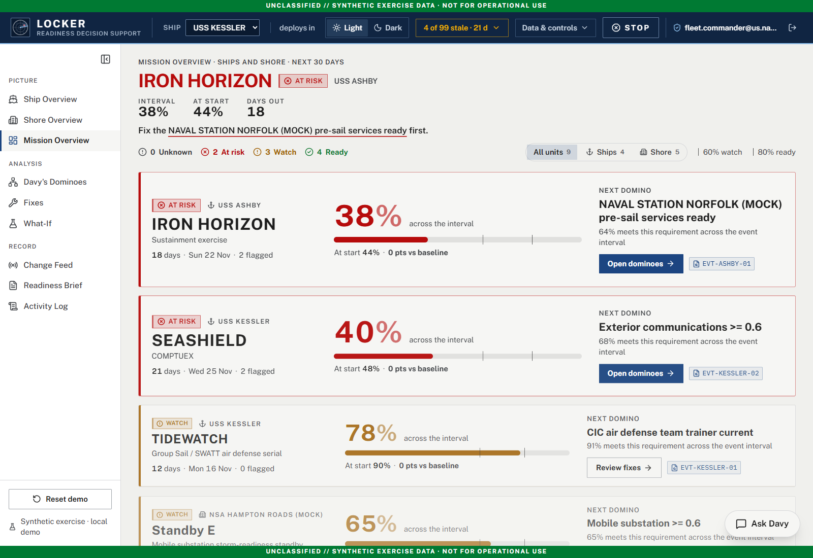

Open `#/missions` to compare the next 30 days of ship and shore events. The headline highlights the most urgent event; cards show the unit, named mission, event type, days remaining, flagged items, change from baseline and the **next domino**, or leading modeled requirement. **All units**, **Ships** and **Shore** filter the picture. Links lead into the dependency graph or recovery options.

Read **across the interval** separately from **at start**. In this captured state, TIDEWATCH is 90% at the start but 78% across its sampled event window. An event can start in good shape and still encounter a training, personnel, equipment or support limitation later. These are modeled exercise estimates, not official readiness ratings or guaranteed mission success.

### 2. Ship Overview: Locate the affected system

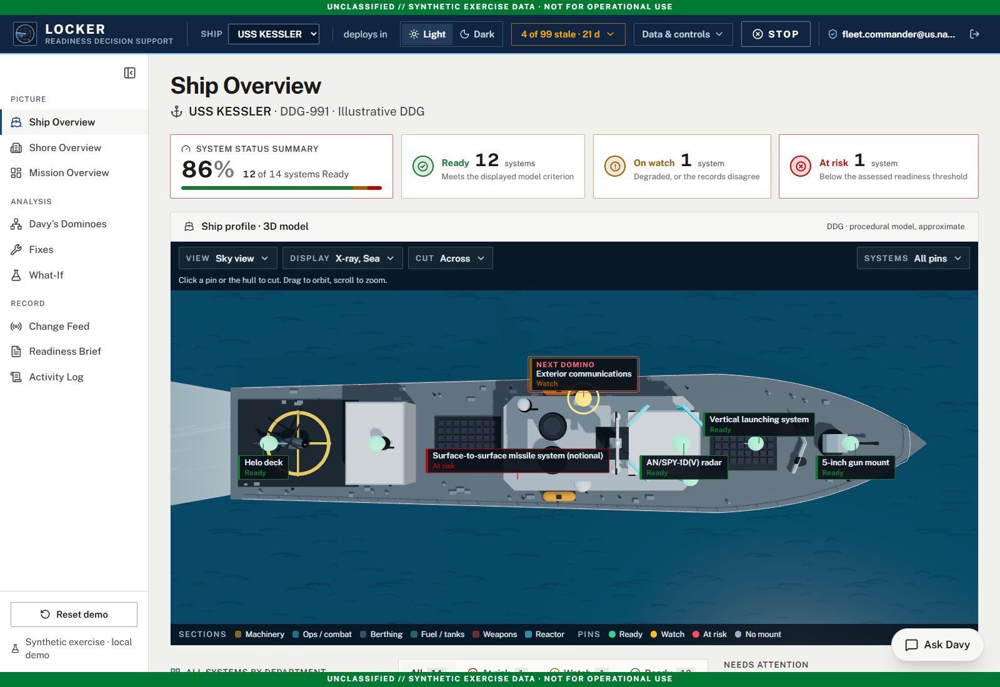

Choose a ship in the header, then open `#/`. The system summary shows Ready, Watch and At risk counts. The illustrative Three.js DDG viewer provides camera views, orbit/zoom, display options, hull cuts and selectable system pins. Scroll below it for systems grouped by department, with odds, assessment basis and data age. Status filters narrow the table, while attention items link back to missions, fixes and Dominoes. Ask Davy can summarize the selected ship or explain its loaded evidence.

**Do not equate the summary percentage with mission probability.** The captured 86% is 12 of 14 systems meeting their displayed criteria. A system's material condition and its scheduled event-interval requirement are different assessment bases. The geometry is approximate, not an engineering drawing.

### 3. Shore Overview: Connect installation support to the ship

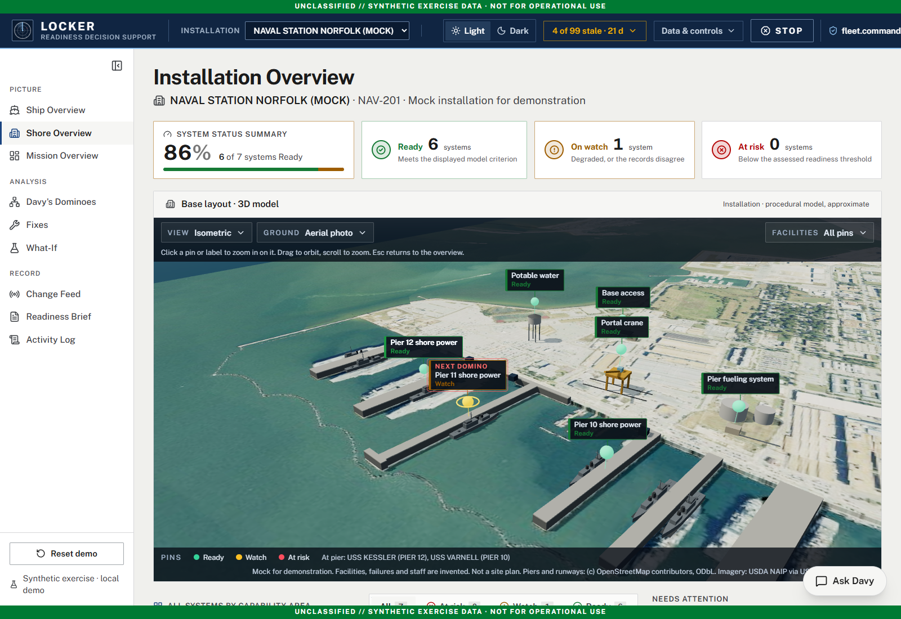

Fleet Commander can open `#/shore` and select an installation. The 3D base view includes camera and ground-display options, facility pins and ships at piers. The table groups systems by capability area, including shore power, cargo and fueling, access and utilities. Attention items expose which pre-sail support event is constrained and which ship mission depends on it. Ask Davy also supports installation-scoped summaries and follow-ups.

In the captured Norfolk mock installation, Pier 11 shore power is on Watch. This helps explain how an installation requirement can affect ASHBY's IRON HORIZON event. Facilities, staffing and failures are synthetic; real geographic imagery does not make the modeled installation an authoritative site plan. Imagery and map attribution remain visible in the application.

### 4. Davy's Dominoes: Trace the dependency chain

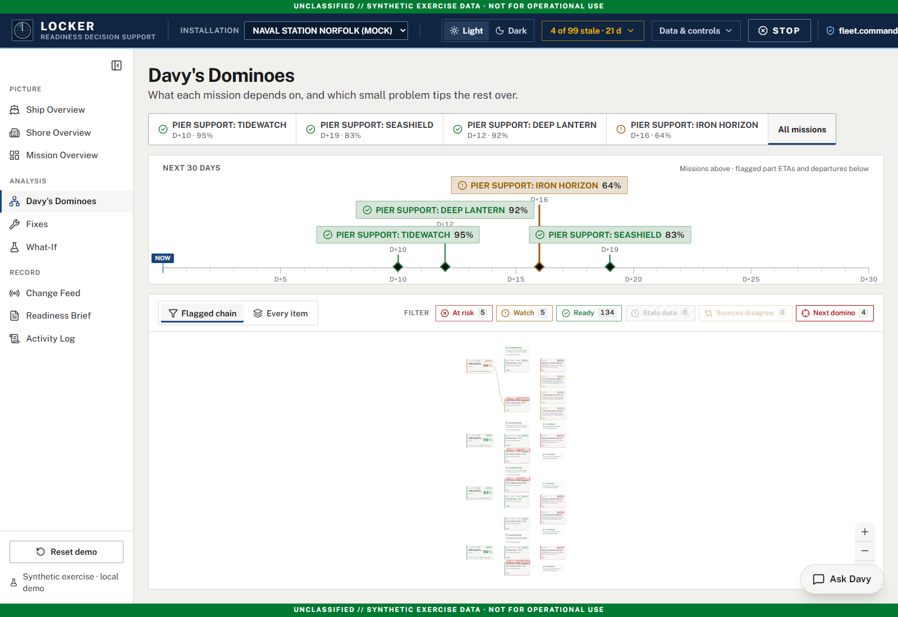

Open `#/dominoes`, select a mission or **All missions**, and follow the chain from mission to requirement to supporting records. The timeline places upcoming events and relevant flagged dates in the next 30 days. **Flagged chain** emphasizes problems; **Every item** expands the picture. Filters identify risk, watch, ready, stale data, conflicting sources and the next domino. Pan/zoom the graph and inspect individual nodes and their evidence.

Mission and graph chat can add **tentative graph suggestions** from reports. Inspect their support and verification steps before marking them reviewed or dismissing them. These are reviewable visual overlays, not new engine facts: reviewing a suggestion does not alter a readiness calculation or approve a fix.

### 5. Fixes: Compare improvement and consequences

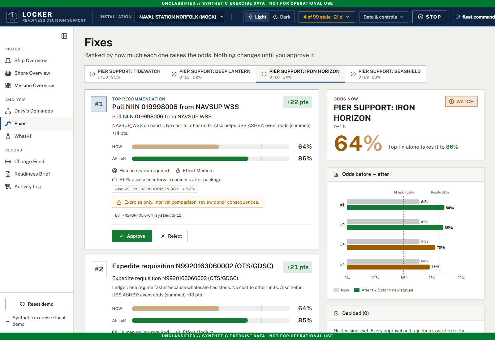

Open `#/fixes` and select an event. Available packages are ranked by modeled improvement, with before/after odds and supporting steps/evidence. Depending on the loaded case, options can include supply expediting, drawing a part from another holder, personnel support or a schedule change. Review timing assumptions and effects on other units, not just the receiver's gain.

The screen supports approval, rejection, supported parameter modifications, a decided-items history and undo subject to account permissions. Nothing is applied merely by opening a recommendation. A CO cannot independently approve a transfer from another unit; Fleet Commander approval is required. A delayed decision must be revalidated, and an immediate-approval ranking is not a promise that the same benefit will remain available later.

### 6. What-If: Test a combination without applying it

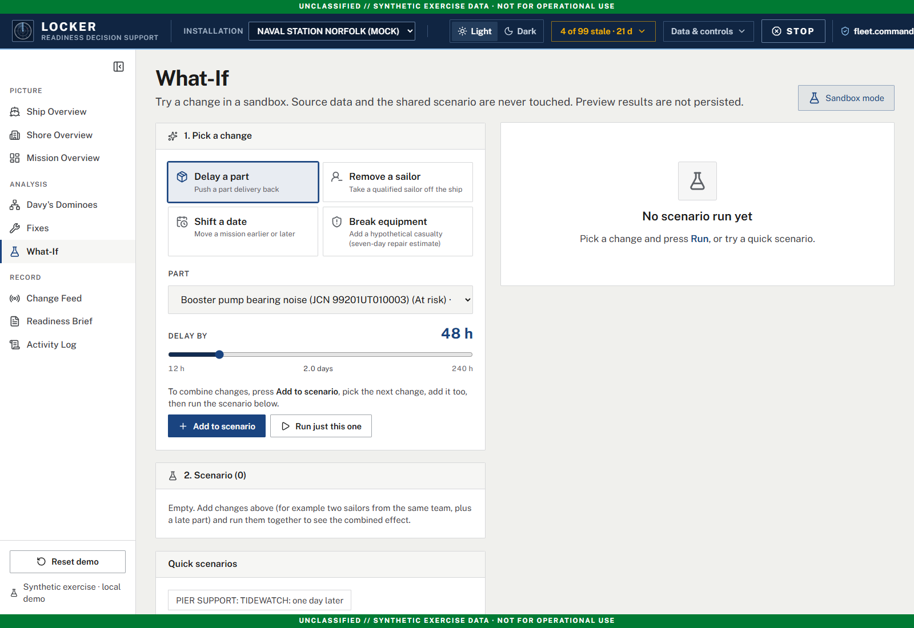

Open `#/what-if` to remove a sailor hypothetically, delay a part, shift a mission or introduce a CASREP category. Choose the target and parameters, use **Add to scenario** to combine changes, and run one change or the whole scenario. Quick scenarios provide starting points. Results compare mission effects and show what would tip over; earlier runs can be compared during the session.

**This screen is sandbox-only.** It does not modify source files or the shared scenario, and its preview results are not persisted. It is separate from approval on the Fixes screen; there is no apply-preview step here.

### 7. Change Feed: Observe new information ripple through the model

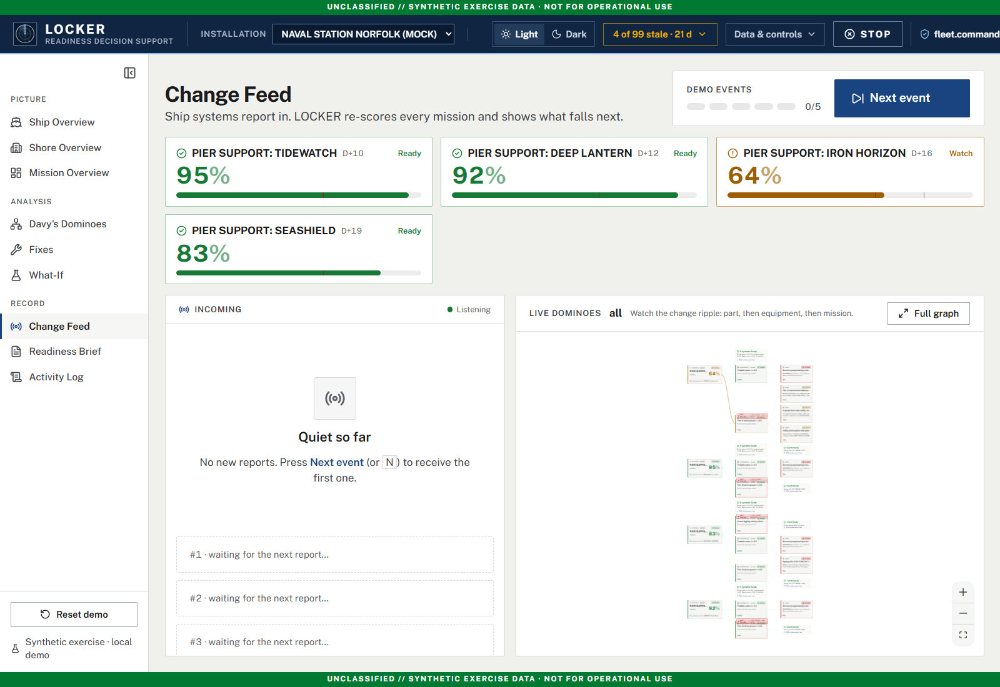

Open `#/feed` for incoming exercise events, an event-progress indicator, mission effects and a live dependency view. Fleet Commander uses **Next event** to release the next scripted update. The engine recomputes the scenario, allowing a presenter to trace a casualty, supply delay, personnel update or schedule change into affected requirements and missions. CO accounts see their relevant updates but do not release the fleet feed.

Playback changes the shared in-memory exercise. Use it deliberately when others are viewing the same server. **Reset demo** restarts the exercise against the current source baseline; it does not rewrite input files. The screenshots in this guide were captured without releasing events or resetting the running exercise.

### 8. Readiness Brief: Explain the current picture with citations

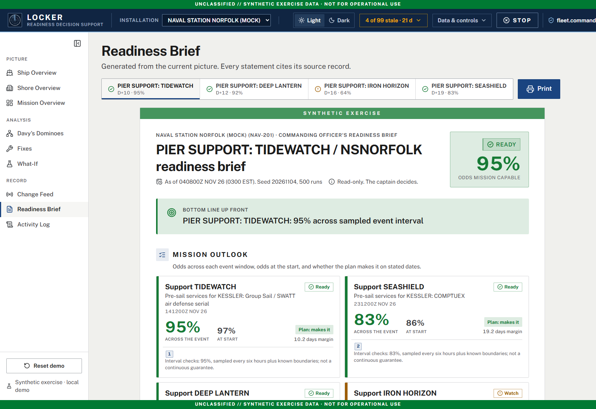

Open `#/brief` and select a mission. The document organizes the current bottom line, mission outlook, next domino, ranked fixes, data warnings and source references. It exposes exercise time and modeling context, including sampled-interval qualifications. Citation markers connect the analysis to its listed sources.

Use **Print** for the dedicated paper layout or the browser's **Save as PDF** option. The current UI is a print workflow, not a separate download button. A usable cited brief does not require a live LLM. Revisit it after scenario or source changes rather than presenting an older output as current.

### 9. Activity Log: Review what happened

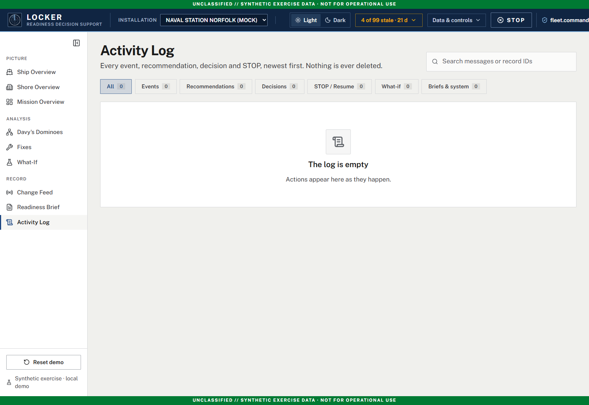

Open `#/log` to search messages and record IDs, or filter by events, recommendations, decisions, STOP/Resume, what-ifs, and briefs/system entries. Recorded changes identify the acting account. The screenshot shows an empty history; no decisions were created just to populate the guide. This audit trail is not a save/load or restart-recovery mechanism.

### 10. Shared controls: Scope, freshness and safe operation

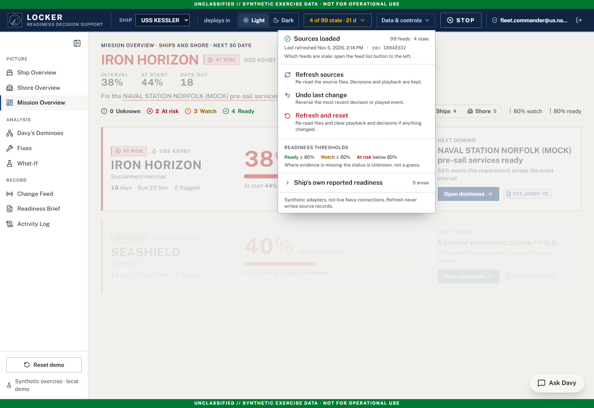

The header selects the active ship or installation and offers light/dark mode, a source-freshness indicator, **Data & controls**, browser-local **STOP** and sign-out. The sidebar can collapse. A CO's accessible units are restricted by the server, not only hidden in the menu.

The freshness indicator opens the feed list. **Data & controls** exposes source revision and refresh time, source refresh, undo, refresh-and-reset, readiness thresholds and the separately reported readiness baseline. In the captured configuration, Ready begins at 80%, Watch at 60%, and lower values are At risk; missing required evidence is **Unknown**, not a fabricated zero. Reported readiness, count-based system summaries and modeled mission probabilities are not interchangeable.

Source refresh validates a candidate snapshot before activation. Rejected changes preserve the prior usable snapshot. Scenario actions and refresh do not write back to source systems. STOP pauses this browser's actions; it is not a fleet-wide emergency stop or a substitute for server access controls.

## Start locally

Tested on Windows with Python **3.13**, Node.js **20+**, and Edge. The frontend is React 19, TypeScript, Vite, CSS, and Three.js; the backend is FastAPI/Python with seeded Monte Carlo calculations.

Install dependencies once (PowerShell, from the repository root):

```powershell
py -3.13 -m venv .venv
.\.venv\Scripts\python.exe -m pip install -r requirements-demo.txt
cd web
npm ci
cd ..
```

Then one command builds, preflights the dataset, and starts the demo with offline ingestion. Ask Davey also stays offline unless you enable its separate live switch:

```powershell
.\.venv\Scripts\python.exe -m missiontwin.demo
```

Open **http://127.0.0.1:8000**. Stop with Ctrl+C. Use `--port 8011` if another server already occupies 8000, and `--no-build` to reuse an existing frontend build.

On Linux/macOS use `python3.13 -m venv .venv` and `.venv/bin/python` in place of the Windows executable. `requirements-demo.txt` pins the direct dependency versions used for local verification; it is not a fully locked transitive dependency graph. `requirements.txt` contains the broader supported ranges.

The canonical synthetic dataset is checked in at `data/synthetic/`. There is no need to regenerate it. `python -m missiontwin.generate` deliberately rewrites that fixture and is intended for fixture development, not routine demo startup.

## Sign-in and access

The app opens on a sign-in screen. For now an account is a username only, with no password:

| Username | Sees | Can do |
|---|---|---|
| `fleet.commander@us.navy.mil` | Every ship and installation (the full site) | Everything, including playing the exercise feed, reset, source refresh, model assumptions and approving transfers between units |
| `co.kessler`, `co.varnell`, `co.ashby` | Their own ship only; no Shore tab | What-ifs, fact review and fix decisions for their own ship. A fix that takes a part or sailor from another unit needs fleet approval. Undo only their own last change |

The server enforces this, not the browser. Every `/api` request must carry the signed session cookie (HttpOnly, SameSite=Strict, 8 hours), and each route checks the account's units. Other units' records are removed before a response is sent, so they never reach a CO's browser. Only the built frontend files, `/api/login`, `/api/accounts`, `/api/health` and a status-only `/api/ready` answer without a session. Sign-ins, sign-outs and refused requests are written to `access.jsonl` next to the activity log, and every change in the activity log names the account that made it. There is one CO account per ship in the data profile, so a new ship gets one automatically (`missiontwin/auth.py`).

## Connected captain UI

The default route now uses Sakie's layout with a top-level ship selector, DDG-only cutaway/interior viewer, and named missions (TIDEWATCH, SEASHIELD, DEEP LANTERN and IRON HORIZON, read from each event's `codename` in `squadron/events_missions.json`). Its data comes from the Python backend, not the browser mock. **Data & controls** (header) exposes source refresh, undo and the readiness thresholds.

The previous advanced workspace (`/?legacy=1`) has been removed; the captain UI is the only front end. The screenshot walkthrough above uses the current screens. See [UI integration status](docs/UI_INTEGRATION.md).

## Ask Davy

### How LLM, RAG and fallback fit together

**RAG means retrieval-augmented generation:** first retrieve relevant loaded evidence, then ask the configured model to explain that bounded evidence. This is not model training, unrestricted web search or a general-purpose autonomous agent.

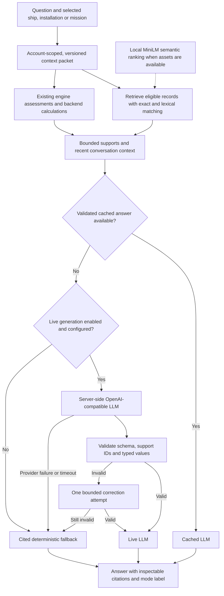

| Layer | What it does | What it does not do |
| --- | --- | --- |
| Data adapters and snapshot | Normalize synthetic maintenance, supply, personnel, training, event and shore records; retain provenance and revision. | Connect to live Navy systems or silently use changed files before refresh. |
| Readiness engine | Calculate existing forecasts, event requirements and trade-offs using configured assumptions and seeded Monte Carlo runs. | Ask the LLM to invent probabilities. |
| Retrieval | Select eligible, exercise-time-visible source records and backend supports for the current scope. Mission/graph retrieval includes maintenance, requisitions, CASREPs and daily reports. | Treat old assistant prose as evidence or perform arbitrary whole-database joins. |
| Local semantic search | Rank eligible records with bundled MiniLM embeddings in a browser worker, alongside exact/lexical matching. | Require a cloud vector database or replace backend numerical queries. |
| LLM | Write a structured, cited explanation using the supplied supports and recent turns. | Approve transfers, mutate the graph's engine state, run what-ifs or issue orders. |
| Validation and rendering | Check support IDs and structured output; insert exact numbers, dates, identifiers and status values from backend supports. | Prove every causal interpretation is correct merely because citations are valid. |
| Deterministic fallback | Route supported questions to versioned templates over eligible records, complete-set backend counts and existing assessments, with citations and a visible reason. | Infer arbitrary causal explanations, run unrestricted joins or replace a general-purpose LLM. |

Semantic search is enabled by default, but requires bundled model assets. When assets or inference are unavailable, standard record search remains usable. **RAG still operates without semantic embeddings.** In the captured live request, the UI reported standard record search. See [local search setup and asset bundling](docs/OVERVIEW_ASSISTANT.md#local-minilm--transformersjs).

### Walk through an actual LLM answer

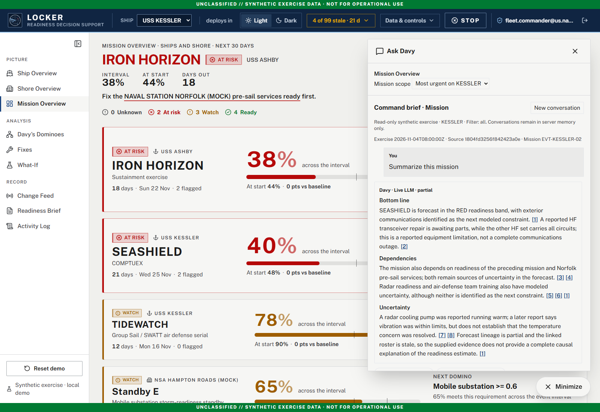

1. Sign in as Fleet Commander, open **Ship Overview**, and select **USS KESSLER**. Then open **Mission Overview**. The mission list can show fleet-wide risks while chat follows the selected header unit; always check the scope shown inside the panel.
2. Open **Ask Davy**. This alone does not submit a question. The captured panel's **Most urgent on KESSLER** scope resolved to **SEASHIELD**. You can also select a named mission explicitly.
3. Click **Summarize this mission**. This is an explicit generation request. Wait for the complete validated answer; the application does not stream unvalidated model text.
4. Check the message label. The captured request returned **Davy · Live LLM · partial**. It explained the communications constraint, reported radio repair, mission/support dependencies and uncertainty. The label **partial** matters: cited model lineage is not a complete causal proof.
5. Click **[2]** beside the reported HF transceiver limitation. The source view below shows the retained maintenance row, its source revision and exercise time. The record reports that the second HF transceiver is awaiting parts and the first carries all circuits; it does not establish a total communications outage.
6. Choose **Back to conversation** and ask a focused follow-up, such as `Which loaded records support the communications concern?` or `What uncertainty remains in this assessment?` Each turn retrieves evidence again; earlier assistant text is conversational context, not a new source.
7. Inspect forecast warnings and any tentative graph suggestions separately. **Trace in Dominoes** or **Show in Dominoes**, when offered, opens the relevant graph context for review. Chat does not apply a recovery action.

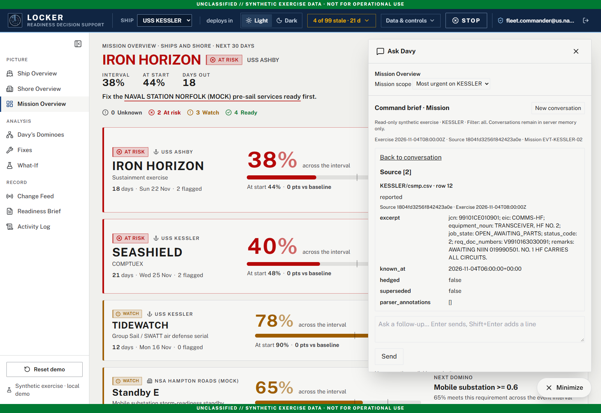

The live answer and retained source detail were both checked against the running app for this guide. Repeating the same summary in a fresh conversation returned **Cached LLM**, demonstrating reuse of a validated answer. That limited observation is not a comprehensive factuality evaluation or an operational certification.

### Recognize the three response modes

| Message label | Meaning | Presenter check |
| --- | --- | --- |
| **Live LLM** | A configured provider returned an answer accepted by the application's validation. | Inspect citations, evidence class and qualifications. |
| **Cached LLM** | A previously generated answer was found in the cache and validated for reuse. | Do not describe it as a new provider call. |
| **Deterministic fallback** | The backend selected a question-specific cited template without a successful model answer. | Check resolved scope, population definition and any explicit limitations or clarification. |

Fallback covers offline/unconfigured generation, context-budget limits, provider rejection/unavailability, timeout, privacy-guard failures and invalid answers/citations. Invalid model output receives at most one correction attempt before fallback. Ordinary provider failure does not need a malformed-answer retry. Unsupported action requests are explicitly refused or redirected to the appropriate workflow rather than executed.

**Live generation available on submit** describes configuration, not the outcome of a request. The individual answer label is the evidence of whether a live answer, cache hit or deterministic summary was used. Disabling live generation can still return a valid cached LLM answer before fallback.

To demonstrate no-provider operation without changing the server on port 8000, open a separate PowerShell terminal and start an isolated offline instance on a free port:

```powershell
$env:LOCKER_DAVEY_LIVE = '0'
.\.venv\Scripts\python.exe -m missiontwin.demo --port 8011 --no-build
```

Open `http://127.0.0.1:8011/#/missions`, sign in and submit a summary. A cache miss yields **Deterministic fallback** with citations; a valid cache hit can still yield **Cached LLM**. For a strictly repeatable no-cache/invalid-provider demonstration, run the isolated [assistant regression tests](tests/test_overview_chat.py): they exercise offline citations and invalid-output correction followed by fallback without calling a real provider. Stop the extra server with Ctrl+C. Do not use Reset demo merely to test generation failure.

### Deterministic questions (no model required)

Ask Davy now selects templates for summaries, modeled status explanations/lists, exact record lookups, maintenance and supply details, complete-set counts, existing dependencies, source quotations and data freshness. Try:

- `How many open jobs?` — counts all eligible selected-unit/focus maintenance rows, not retrieved top-k snippets. Open means `OPEN`, `OPEN_AWAITING_PARTS`, `IN_WORK` or `DEFERRED`.
- `Which repairs are awaiting parts?` — filters recorded `job_state`; verified JCN links may show corresponding requisitions.
- `Show JCN <identifier>` or `What is requisition <document-number>?` — exact lookup, never substitution with a nearby identifier.
- `What is wrong with the HF transceiver?` — relevant recorded maintenance, not a claim of total communications failure.
- `What data is missing?`, `Explain this dependency`, or `Show the supporting records`.

Check **Deterministic only (bypass model and cached LLM)** to explicitly avoid both provider requests and model-cache answers. Default mode still permits validated cached/live generation before deterministic fallback. Local semantic inference may still run; missing assets fall back to lexical search. Mission/Dominoes now use the same searchable-text worker contract, with question-ranked bounded candidates rather than a fixed first-300 population.

Unknown/ambiguous requests receive clarification rather than an unrelated summary. Supply ESD remains an estimate, not guaranteed delivery or repair completion. Training/certification templates expose recorded dates but do not infer complete event-window qualification rules. Cross-mission comparisons, undefined late/negative filters and arbitrary before/after snapshot comparisons are explicitly unavailable, not fabricated. See the [deterministic retrieval/template plan and delivery record](docs/ASK_DAVY_DETERMINISTIC_RAG_IMPLEMENTATION_PLAN.md).

### Enable live Ask Davy

Keep configuration in the repository-root ignored `.env` or the server process environment. Use an approved OpenAI-compatible endpoint and an exact model ID available to your account:

```dotenv
LLM_BASE_URL=https://api.openai.com/v1
LLM_MODEL=<your-approved-model-id>
LLM_API_KEY=<server-side-key>
LOCKER_DAVEY_LIVE=1
MISSIONTWIN_DEMO_MODE=1
```

These are placeholders, not usable credentials. `LOCKER_DAVEY_LIVE=1` explicitly enables assistant calls while `MISSIONTWIN_DEMO_MODE=1` keeps ingestion, action parsing and briefs offline. Setting demo mode to `0` instead permits other configured live paths too; it is not required solely to enable chat when the assistant override is set. Explicit `LOCKER_DAVEY_LIVE=0` wins over the inherited live/demo state. Process environment takes precedence over `.env`; restart the backend after changing it.

Build the frontend, then start the API directly for this split-mode setup:

```powershell
npm --prefix web run build
.\.venv\Scripts\python.exe -m uvicorn missiontwin.api:app --host 127.0.0.1 --port 8000 --workers 1
```

Use another free port if 8000 is already occupied. The demo launcher forces offline application behavior unless the assistant's separate live switch is enabled. Keys stay server-side: never place them in `VITE_*` settings, screenshots, committed files or chat. A cloud provider receives the selected redacted context, so local key storage does not mean generation is local. OneDrive can sync an ignored local configuration; use an approved non-synced location when required.

### Conversations, scope and boundaries

All four overview/graph views use the same floating **Ask Davy** panel, conversation service, default local semantic search, and inline citation renderer. Opening the panel or changing scope makes no generation request. **Send** and summary/follow-up buttons explicitly submit a question. Mission/Dominoes combine eligible requisitions, maintenance records, CASREPs and daily reports with typed engine forecast supports. Numbers and exact values are inserted by the backend, not calculated by the model. Citations open recorded evidence or modeled assessments with partial-lineage warnings.

Mission Overview and Davy's Dominoes use the same floating chat presentation as the Ship and Shore assistants, with forecast warnings, report evidence, and graph suggestions. They keep separate chats. Switching pages closes the popup; reopen it to see that page's chat. **New conversation** clears the active page's chat. Mission scope follows the selected unit in the header and is shown in the popup. **Show in Dominoes** carries a Mission Overview graph suggestion into Dominoes for review while leaving the chat history on Mission Overview.

Generation policy is shared across all four views: explicit `LOCKER_DAVEY_LIVE=0` disables fresh assistant calls; `1` enables configured assistant calls even with offline ingestion; when absent, assistants inherit the application's live/demo state. The default demo remains offline. Configure server-side `LLM_BASE_URL`, `LLM_MODEL` and `LLM_API_KEY`, then restart. `MISSIONTWIN_DEMO_MODE=1` still keeps ingestion, action parsing and briefs offline. The key is never sent to the browser. Answers distinguish **Live LLM**, **Cached LLM** and **Deterministic fallback**; a live-capable status is not proof a call succeeded. Strict schema is preferred, with validated JSON-object fallback only for an explicit unsupported-format response.

Live answers can identify **emerging concerns** and propose report-supported nodes and connections in Dominoes. These are labeled **Tentative graph suggestions · Needs verification** and can be inspected, marked reviewed, dismissed, or restored. Review changes only the visible overlay; it never changes readiness or applies an action. Conversations restore through opaque sessionStorage IDs, are owned by the signed-in account/browser, and expire from bounded server memory. Changed exercise/source context is marked historical and cannot accept new questions until a fresh conversation is started; historical captured citations remain inspectable, not evidence of current state. Restart loses in-memory conversations. A live answer requires a configured key and endpoint; the screenshot walkthrough above includes an actual live response, while regression tests use isolated offline or mocked transports. See the [assistant details](docs/OVERVIEW_ASSISTANT.md), [brainstorm](docs/ASK_DAVEY_BRAINSTORM.md) and [implementation plan](docs/ASK_DAVEY_IMPLEMENTATION_PLAN.md) for additional context and limits.

## Five-minute presenter walkthrough

1. **Mission Overview:** compare TIDEWATCH's start and interval estimates, then open the leading constraint for a flagged mission. Explain that sampled interval readiness is not a continuous-time guarantee.
2. **Ask Davy:** select KESSLER, summarize SEASHIELD, identify the response-mode label and open a citation. Ask one evidence-focused follow-up.
3. **Ship / Shore Overview and Dominoes:** locate the system or facility, then trace its requirements and supporting records. Keep material condition, event-interval gates and count-based summaries distinct.
4. **Fixes:** compare receiver gains, timing and donor consequences. Only approve a decision if changing this shared exercise is intended.
5. **What-If:** run a sandbox scenario and compare the results. This screen never applies the preview to the shared scenario.
6. **Change Feed and Data & controls:** inspect freshness, source revision, reported baseline and errors. In a presenter-owned exercise, use Next event to show a recomputation; playback changes shared state.
7. **Readiness Brief and Activity Log:** inspect the cited brief, use Print/Save as PDF, and review recorded actions. A live model is not required for the brief.

## Demonstrate replacement sources

Work on a copy so the checked-in fixture remains untouched:

```powershell
Copy-Item data/synthetic data/demo-refresh -Recurse
.\.venv\Scripts\python.exe -m missiontwin.demo --data data/demo-refresh --port 8011
```

1. Play the first event (casualty).
2. In `data/demo-refresh/KESSLER/requisition_status.csv`, change `BB 2026-11-05` to `BB 2026-11-12` in the pump requisition's `status_history`.
3. Open **Data & controls → Refresh sources**, review the confirmation, and confirm.
4. The revision changes and the supply evidence and start-time readiness change without restart. Reopen the dependency chain, compare options, and generate a new brief. Interval readiness moves with the supply change; the CIC trainer refresh is scheduled in port (10 NOV), so training is not an independent blocker. A training refresh dated inside an underway block is rejected at refresh.
5. Refresh again without editing: it is an idempotent no-op. Remove a required source and refresh: the candidate is rejected, the prior snapshot remains active, and a failure banner appears.

Existing hypothetical decisions block activation of changed sources. The explicit **Reset exercise when activating changed sources** checkbox permits replacement with a clean scenario. Without overlays, compatible event playback is retained. See [source contracts and adapter details](docs/SOURCES.md).

A second input format uses JSON exports instead of CSV:

```powershell
.\.venv\Scripts\python.exe -m missiontwin.export --output data/demo-json
.\.venv\Scripts\python.exe -m missiontwin.demo --data data/demo-json --adapter json-export --port 8011
```

The adapter materializes canonical records in a temporary snapshot; it does not write CSV into the input export directory. The evidence drawer links normalized CSV rows to the preserved raw JSON export. Both formats use the same engine/UI.

## Checks and development

For the assistant behaviors described in this guide, run the focused offline/mocked suite:

```powershell
.\.venv\Scripts\python.exe -m pytest -q tests/test_overview_chat.py
```

It covers cited offline summaries, history/clear, structured live responses with a mock provider, rejected numbers/support IDs, one correction followed by fallback, read-only behavior, stale context and session isolation. During this walkthrough update, all eight tests passed. The live and cached modes were also observed separately in the running app; no provider outage was induced on the shared server.

Broader project checks:

```powershell
.\.venv\Scripts\python.exe -m pytest -q
.\.venv\Scripts\python.exe scripts/check_demo.py
```

`check_demo.py` typechecks/builds the frontend, copies the dataset to a temporary directory, starts an offline API on a free local port with a temporary activity log, and runs Playwright. It exercises source replacement and then tears down only its own server. **It never resets an existing server on 8000.** Edge is used by default on Windows; on other platforms install Chromium with `cd web; npx playwright install --with-deps chromium`. Set `PLAYWRIGHT_CHANNEL=chromium` to select it explicitly.

Individual frontend commands: `npm run typecheck`, `npm run build`, `npm run dev`, and `npm run test:e2e` in `web/`. The last command defaults to an existing server on port 8000 and **resets that server's exercise**; prefer the isolated runner. Vite's development proxy defaults to the local API on 8000.

The GitHub Actions workflow runs backend and isolated browser checks. It is supplied but has not been exercised on hosted CI as part of local verification. Docker/Kubernetes/Zarf packaging exists but is not a verified production deployment.

## Configuration and behavior

| Setting | Purpose |
| --- | --- |
| `MISSIONTWIN_DATA` | Input directory for the configured adapter |
| `MISSIONTWIN_ADAPTER` | `directory` (default) or `json-export` |
| `MISSIONTWIN_DEMO_MODE=1` | Guaranteed offline extraction/actions/briefs; forced by the launcher |
| `LLM_BASE_URL` | OpenAI API base URL for live Davey (example: `https://api.openai.com/v1`) |
| `LLM_MODEL` | Structured-output model for live Davey (example: `gpt-4o-mini`) |
| `LLM_API_KEY` | Server-side OpenAI Platform API key; keep it in ignored `.env` or the process environment |
| `LOCKER_DAVEY_LIVE` | Shared assistant override: `1` live on explicit submit, `0` validated cache/fallback only; absent inherits app live/demo state |
| `MISSIONTWIN_ACTIVITY_LOG` | Optional activity-log path; see `missiontwin/domain.py` for the default |
| `MISSIONTWIN_SESSION_SECRET` | Optional key for signing session cookies. Without it each server start makes a new key, which signs everyone out |
| `LOCKER_URL` | Target URL for standalone browser tests |
| `PLAYWRIGHT_CHANNEL` | Optional browser channel override |

For direct API startup, set those variables and run `python -m uvicorn missiontwin.api:app --host 127.0.0.1 --port 8000`. API documentation is at `/docs` (sign in first); `/api/health` checks liveness and `/api/ready` checks source/configuration readiness (503 after a failed refresh or with insufficient evidence).

- One shared, in-memory scenario per process; use **one worker**. Writes require `base_version` and stale writes return 409.
- Sources are immutable inside the active snapshot. Changed input files have no effect until refresh. Scenario actions never modify inputs.
- Restart loads sources afresh and resets the in-memory exercise. The activity log is an audit trail, **not** restart recovery/save-load.
- Start-time probability remains `p_ready`; primary interval assessment is `p_assessed`/`interval_p_ready`. Missing required evidence yields `null`/`UNKNOWN`, not a fabricated zero or green value.
- Feed freshness is evaluated against exercise time, not today's wall clock. A stale record is still visible with a warning; a required missing/invalid feed causes insufficient coverage.
- The separately normalized reference package is review-only. Do not point the active adapter at it and assume it is equivalent to the canonical exercise.

## Troubleshooting

- **No frontend / stale UI:** run the launcher without `--no-build`, then hard-refresh the browser.
- **Port occupied:** use `--port 8011`; do not stop an unknown process.
- **Refresh rejected:** inspect the error and source health. Correct schemas/IDs/timestamps, or explicitly reset overlays before activating changed inputs. The prior usable snapshot is retained.
- **Missing evidence:** restore required files and joins, then refresh. For a malformed initial configuration use `/api/sources`/`/api/ready` or the launcher error; the main forecast is intentionally blocked.
- **No WebGL:** the system list and evidence actions remain available; no 3D requirement is imposed on forecasting. A richer schematic/print fallback is still follow-on work.
- **Warnings:** the Three.js chunk is large; this is a build warning, not failure. The installed Starlette test client emits an httpx deprecation warning.

## Project map and limits

- **Only the data is hardcoded.** Units, equipment, parts, watchstations, events, the scenario clock, the ship drawing layout,
  supply holder roles, source coverage and every model number come from the dataset (`squadron/dataset_profile.json`,
  `mission_equipment_tree.json`, `shore_profile.json`, `delay_model_params.yaml`, `data_catalog.json`,
  `status_code_reference.csv`). `missiontwin/synthetic_spec.py` is the generator's authoring input for the synthetic
  dataset and only the generators import it; `tests/test_data_only.py` enforces this.
- `missiontwin/profile.py`, `sources.py`, `ingest.py`, `validation.py`: profiles, adapters, snapshots, validation and provenance.
- `engine.py`, `fixes.py`, `brief.py`: calculations, package comparison, and cited output.
- `web/src/`: live workspace, source health, dependency graph, timeline, and illustrative ship.
- [MVP review and delivery status](MVP_REVIEW.md): original findings, implementation evidence, and explicit limitations.
- [Original design handoff](docs/DESIGN_HANDOFF.md): preserved aspirational design, **not** current installation instructions or implemented scope.
- `data_sources/`, `reports/`: source research and the separate reference exercise.

Movement messages constrain schedule-derived transfer windows; positions remain context-only. Watchbill optimization, maintenance labor competition/IEM, and INSURV scoring are not implemented and are labeled accordingly in source health. Real adapters still require approved schemas, identity/time mappings, authorized access, and security review. Live LLM wording has numeric/citation guards, but is not a factual-equivalence or comprehensive PII guarantee.
