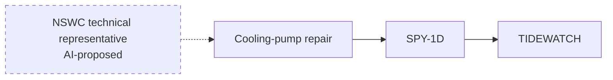

# Ask Davey: predictive LLM brainstorming

Date: 2026-11-05
Status: Brainstorming record; first prototype implemented.
Scope: Mission Overview and Davy's Dominoes.

This document captures the decisions, examples, alternatives, and open questions from the brainstorming conversation. It distinguishes user-selected direction from suggested details that still need refinement.

The selected approach is developed in the [Ask Davey implementation plan](ASK_DAVEY_IMPLEMENTATION_PLAN.md) and the first local prototype. A later design adjustment changed the original full-height drawer idea into a compact popup above the fixed button. The other choices recorded here remain the product requirements.

## 1. Goal and selected direction

Build a **usable prototype first**, with a compelling hackathon demonstration and room for research and exploration. The primary job is **early warning**: help someone identify a developing problem, understand when it matters, and trace why it threatens a mission.

Early warning describes the content of Davey's answers, not continuous monitoring. The user explicitly chose analysis on request.

| Topic | Decision |
| --- | --- |
| Leading goal | Usable prototype; demo value and exploration are supporting goals |
| Primary job | Early warning |
| First walkthrough | Parts and repairs |
| Implementation approach | **B: searchable evidence service**, combining the authoritative forecast with relevant report evidence retrieved for each submitted question |
| Live-model provider | **OpenAI API**, using the user's existing OpenAI Platform API key in server-side configuration; model choice remains configurable |
| Warning scope | Both known future constraints and emerging concerns inferred from evidence |
| Dependency scope | The LLM may suggest relationships missing from the modeled graph |
| New-node scope | The LLM may propose new nodes supported by reports, as tentative suggestions for review |
| Suggested relationships | Tentative, supported by evidence, and presented for human review; separate from calculated readiness |
| First-prototype review scope | Reviewable suggestions only; reviewing does not apply a proposed node or dependency to the modeled graph or a what-if scenario |
| Entry point | A persistent **Ask Davey** button |
| Interface | A compact floating assistant popup above the Ask Davey button on Mission Overview and Davy's Dominoes |
| Analysis trigger | Someone opens the popup and submits a question |
| Background analysis | Not selected; opening the popup alone does not trigger analysis |

## 2. What "predictive" means here

Three possible jobs were discussed:

1. **Early warning:** identify something that looks acceptable today but threatens an upcoming mission. This is the selected lead workflow.
2. **Explain consequences:** explain how a known problem, such as a delayed part, affects equipment, people, and missions. This supports warning explanations.
3. **Compare responses:** compare modeled actions and their trade-offs. This remains a possible follow-on capability; it is not the lead requirement for this increment.

The two warning types selected for the prototype are:

| Type | Meaning | Examples discussed | Presentation direction |
| --- | --- | --- | --- |
| Forecasted warning | A known future constraint with impact supported by the existing engine | Qualifications expiring during a mission, expected part arrivals, maintenance dates, schedule conflicts | Explain the calculated impact and link the underlying evidence |
| Emerging concern | A pattern or possible dependency identified from reports that merits investigation | Repeated repair delays, unresolved dependencies, assistance mentioned in reports but missing from the graph | Label as needing verification; cite the evidence and explain what needs checking |

Readiness probabilities remain engine calculations. The LLM connects and explains evidence and can propose hypotheses. A tentative connection does not become a calculated readiness effect simply because the LLM suggested it.

An emerging concern may concern timing or impact that the available evidence cannot establish. The answer should make that gap explicit rather than supply a fabricated date, probability, or consequence.

## 3. Ask Davey interaction

The selected interaction is a floating assistant popup opened by **Ask Davey**, available on both target pages.

Proposed flow, consistent with the selected on-request trigger:

1. The user opens **Ask Davey**.
2. The popup shows its scope, an input, suggested questions, and a short in-tab answer history. Opening it does not request new analysis.
3. The user submits a question. Selecting a suggested question fills the input; pressing **Ask** submits it.
4. Davey analyzes the relevant current evidence and modeled state, then returns warnings and explanations.
5. The user can inspect evidence or trace a warning in Davy's Dominoes.
6. Follow-up questions explicitly request additional analysis.

Suggested questions discussed or derived from the selected early-warning workflow:

- What looks acceptable today but threatens this mission later?
- What emerging concerns are supported by the reports?
- Explain this warning.
- What evidence supports this proposed connection?
- What should I verify next?

The current mission or selected graph node was proposed as the assistant's context. The prototype uses the selected unit and mission, chooses that unit's most urgent mission when scope is set to all, and retains a short answer history for each page. The popup labels the active page's chat and provides **New conversation** to clear that page's chat. Explicitly tracing a Mission Overview suggestion shows it on the Dominoes graph without copying the Mission Overview conversation into the Dominoes chat.

### Trigger constraints

- No new Davey analysis just because a page renders, the popup opens, or the user navigates.
- No automatic Davey analysis on source refresh or a scenario change.
- The proposed automatic-analysis/new-warning badge is superseded by the user's on-request choice.
- Changes to the underlying state should mark an existing answer as outdated without automatically regenerating it. This is a proposed implementation behavior to preserve the selected trigger.
- These constraints concern the new Davey assistant. They do not disable the application's existing forecasting or ingestion behavior.

## 4. Making the LLM element visible

The user specifically asked how the page could make the LLM element recognizable, then chose the **Ask Davey** button and floating assistant. A later adjustment specified a compact popup above the button.

Supporting UI ideas proposed for refinement:

- Put a small **AI** label beside the Ask Davey button.
- Identify the popup as **Davey**, with a subtitle such as **LLM-assisted risk analysis** or **AI Early Warning**.
- Display **Analyzing...** while a submitted request runs.
- Report the actual answer source: **Live LLM**, **Cached AI**, or **Rules-based fallback**.
- Use follow-up questions, source-linked explanations, and proposed connections to make the assistant's role apparent.
- Distinguish **Forecasted warning** from **Emerging concern / Needs verification**.
- Show the state or time the answer describes so a previous analysis is not mistaken for a current one.

The initial brainstorming left placement, dimensions, styling, and mobile behavior open. The current prototype uses a compact right-aligned popup above the fixed button, with width and height capped on small screens.

### Mission Overview

The popup discusses the selected mission's developing risks while preserving space for the existing mission list. Warning actions proposed during discussion were **Explain this warning**, **View evidence**, **Trace in Dominoes**, and **Ask a follow-up**.

### Davy's Dominoes

The same popup explains the selected warning or graph node. **Trace in Dominoes** highlights the relevant dependency chain. Suggested relationships appear as dashed links explicitly labeled **AI-proposed**. Report-supported new nodes are also in scope; a matching dashed outline and **AI-proposed** label distinguish them.

Inspecting a proposed node or link shows the supporting records, the suggestion, and what needs verification. For the first prototype, review is informational: it does not apply a suggested node or dependency. The prototype provides mark reviewed, dismiss, and restore controls in the current tab.

## 5. Proposed nodes and dependency links

The user selected allowing the LLM to propose missing relationships and new nodes supported by reports, rather than limiting it to entities and relationships already in the graph.

The intended distinction is:

- Existing modeled relationships support the engine's calculations.
- AI-proposed nodes and relationships are suggestions for review, displayed separately and visibly tentative.
- A new node must be supported by a report. For example, a report may identify an outside repair team that is not represented in the existing graph.
- A suggested relationship includes evidence and an explanation of why it may matter.
- A report mentioning an entity can support a proposed node without establishing every proposed relationship to that entity. The node and each suggested link need their own supporting evidence and explanation.
- Displaying a suggestion does not modify the modeled graph or recalculate readiness through that suggestion.
- The user selected **reviewable suggestions only for the first prototype**. Reviewing a proposed node or link does not promote it into the modeled graph, apply it to a what-if scenario, or change calculated readiness.

The first prototype accepts source-backed support teams, organizations, parts, repair tasks, and equipment as tentative nodes. It checks labels against existing graph targets, restricts links to an existing dependent and a proposed dependency, and keeps review state in the current tab. Applying a suggested node or dependency to a what-if scenario or the authoritative model is outside the selected first-prototype scope; any future promotion workflow would require a separate design decision.

## 6. Warning examples and selected walkthrough

The first two examples are illustrative product ideas. The concrete walkthrough below them is based on inspected synthetic source records. None are findings from a live Davey run.

### Known future constraint

> The ship meets this requirement today, but a crew qualification expires during the mission.

The assistant explains the future gap using the existing forecast. Selecting the warning highlights the qualification-to-mission dependency and exposes the source record.

### Emerging concern with a missing relationship

> **AI Early Warning**
> Emerging concern - Needs verification
>
> **Repair timing may conflict with the mission window.**
> Recent reports suggest the repair depends on assistance that is not represented in the current dependency graph.
>
> Supporting records | Proposed connection
> View evidence | Trace in Dominoes | Ask a follow-up

This example was initially shown as an embedded warning card. Its content can live inside the selected popup. Record counts, dates, and claimed effects must come from the actual evidence available to a request.

If the report identifies an outside repair team, Davey could propose a tentative team node and a supported link to the affected repair. The team, link, and possible mission consequence remain suggestions for review. The source mention does not by itself establish an arrival date, availability, or numerical readiness impact.

### Selected theme: parts and repairs

The user selected **parts and repairs** as the first walkthrough. The first prototype uses **KESSLER / TIDEWATCH / the SPY-1D cooling-pump repair** as its acceptance scenario.

Existing source support:

| Evidence | What it establishes |
| --- | --- |
| [Initial CASREP 017](../data/synthetic/KESSLER/casrep_messages/DDG991-26-017_01_INITIAL.txt) | A cooling-water pump casualty, the affected SPY-1D system, the repair job and part identifiers, and requested assistance from `NSWC TECH REP` |
| [CASREP update](../data/synthetic/KESSLER/casrep_messages/DDG991-26-017_02_UPDATE.txt) | A long supply delay, a stated 15 DEC estimated shipping date, and a revised reported repair estimate |
| [Requisition status](../data/synthetic/KESSLER/requisition_status.csv) | Requisition `V9910163080001`, pump NIIN `019990001`, and the timestamped change from BB to BC with a 15 DEC estimated shipping date |
| [05 NOV daily report, page 1](../data/synthetic/KESSLER/daily_reports/daily_status_KESSLER_20261105.pdf) | A tentative report that the NSWC technical representative's visit may slip to 12 NOV due to travel; it is not a confirmed arrival date |
| [Scenario feed](../data/synthetic/squadron/scenario_feed.json) | E2 makes the supply update available at 05 NOV 10:00Z; E3 reaches the daily report's as-of time of 06 NOV 01:00Z |

Proposed walkthrough:

1. At exercise state E2, open **Ask Davey** and submit a question such as "What parts or repair issues threaten TIDEWATCH?" The answer explains the supply constraint using the current engine assessment and eligible records.
2. Advance the exercise to E3. The previous answer becomes outdated; advancing the exercise does not automatically ask Davey to analyze again.
3. Submit a new question. Davey can now cite the tentative technical-assistance travel report as an emerging concern and identify the visit schedule as something to verify. The E3 report must not appear in the E2 answer.
4. Offer an **AI-proposed NSWC technical representative node**, grounded in the assistance request and eligible report evidence, linked tentatively to the cooling-pump repair.
5. **Trace in Dominoes** shows the proposed node and link alongside the existing repair-to-system-to-mission chain. Reviewing the suggestion leaves the modeled graph and readiness estimates unchanged.

Conceptual dependency path for this example:

This is a conceptual illustration, not an exported runtime graph or a new calculated dependency.

Important findings for implementation planning:

- The engine already supports a repair constraint from a confirmed assistance date. The current captain graph adapter does not create a separate technical-representative node. Davey must distinguish making an existing concept visible from discovering an entirely unmodeled constraint, and avoid double-counting modeled effects.
- The travel report is hedged. Davey must retain "may slip" and identify verification needed, rather than assert a confirmed delay or invent its probability.
- The CASREP update states a 22 NOV repair estimate while also describing a 15 DEC estimated shipping date plus transit and installation. Preserve these as separate reported values and flag the inconsistency where relevant; do not invent a reconciled completion date. A shipping estimate is not a delivery date.
- Use the engine's active mission dates at the exercise cursor. The later E4 schedule change and other future information must not leak into earlier answers.
- Other modeled mission blockers may still exist. The walkthrough focuses on parts and repairs without claiming they are the mission's only risks.

## 7. Alternatives considered

| Alternative | Outcome |
| --- | --- |
| Optimize primarily for an impressive hackathon demonstration | Demo value retained, but a usable prototype leads |
| Focus primarily on research and exploration | Exploration retained as a supporting goal |
| Lead with consequence explanations or response comparisons | Early warning selected; explanations support it, comparisons remain a possible extension |
| Analyze only known future constraints | Both warning types selected |
| Analyze only emerging concerns from reports | Both warning types selected |
| Limit the LLM to the existing dependency graph | User selected proposing missing relationships too |
| Allow new links only between existing graph nodes | User selected allowing new nodes supported by reports too |
| Put an AI Early Warning panel above the mission list and an AI Analysis panel beside the graph | User selected a floating Ask Davey assistant instead |
| Open a floating drawer from an Ask AI button | Selected **Ask Davey** trigger; presentation later refined to a compact popup |
| Automatically analyze report or mission changes and display a new-warning badge | User selected waiting for an explicit question instead |
| Allow reviewed dependencies to enter a separate what-if scenario | User selected reviewable suggestions only for the first prototype |
| Start the walkthrough with crew readiness or shore support | User selected parts and repairs; these remain possible later examples |

## 8. Existing foundations to reuse

Repository inspection established the following starting points:

| Component | Existing foundation |
| --- | --- |
| [Mission Overview](../web/src/captain/screens/Overview.tsx) | Readiness estimates, mission ordering, and the main blocker |
| [Davy's Dominoes](../web/src/captain/screens/Dominoes.tsx) | Dependency graph, timeline, mission selection, and node inspection |
| [Forecast engine](../missiontwin/engine.py) | Calculated readiness and dependency assessments |
| [LLM wrapper](../missiontwin/llm.py) | Optional report extraction, natural-language action parsing, and brief generation; client, validation, cache, and fallback patterns |
| [Brief generation](../missiontwin/brief.py) | Existing cited readiness-brief behavior |
| [Captain API adapter](../web/src/captain/api/api.ts) | Frontend adaptation of mission, graph, and evidence data |

The [Captain decision assistant implementation plan](CAPTAIN_DECISION_ASSISTANT_PLAN.md) is related prior planning. It proposes a mission-specific decision brief, evidence retrieval, and bounded follow-ups. It is not shipped assistant functionality.

This brainstorm establishes a different primary UI entry point: **Ask Davey** on Mission Overview and Davy's Dominoes. It also explicitly includes tentative missing-dependency suggestions and report-supported new nodes. Useful evidence handling and state-management ideas from the earlier plan can inform the eventual implementation design; its entire scope has not been adopted here.

The existing demo launcher forces offline ingestion LLM behavior. The user selected the **OpenAI API** and already has a Platform API key to configure locally. Davey's separate `LOCKER_DAVEY_LIVE` switch permits calls only on submitted questions while existing ingestion stays offline. The prototype defaults to configurable `gpt-4o-mini`; no new runtime package was needed.

## 9. Remaining evaluation questions

The first prototype settled routine UI, scope, and session defaults. These questions remain for a live evaluation or later iteration:

1. Does a live model reliably preserve hedging and propose the right NSWC link in the KESSLER/TIDEWATCH E2-to-E3 walkthrough?
2. How should aliases identify an existing entity under a different name before suggesting a new node?
3. What is an acceptable response time and API cost per question, and should another structured-output model replace the current default?
4. Should conversations and reviewed suggestions persist beyond the current tab?
5. Should the current most-urgent mission selection and 30-day view use a more explicit urgency rule?
6. Is the currently eligible report history sufficient for repeated-delay claims, or does the search need more source types?

## 10. Next validation steps

The user selected parts and repairs, **approach B**, and the **OpenAI API**. The [implementation plan](ASK_DAVEY_IMPLEMENTATION_PLAN.md) records the implemented approach around the KESSLER/TIDEWATCH walkthrough. The next check is a live, key-backed evaluation of response quality and latency.

Walkthrough themes discussed:

- **Parts and repairs - selected:** a known supply constraint alongside a report-supported concern about outside repair assistance; the assistance team can appear as a proposed node. Relevant synthetic source records have now been inspected.
- **Crew readiness - possible later example:** a qualification expiration alongside a report-supported concern about personnel availability.
- **Shore support - possible later example:** a scheduled support requirement alongside a report-supported concern about a pier, service, or outside support dependency.

Candidate acceptance checks for that later plan:

- Opening the popup causes no new analysis; submitting a question does.
- A supported future constraint produces an explanation consistent with the engine's numbers.
- An emerging concern cites relevant evidence and identifies what needs verification.
- Proposed nodes and links are visibly tentative and leave calculated readiness unchanged.
- A proposed new node links to the report that supports it; each suggested relationship has its own supporting evidence.
- Reviewing a suggestion changes no modeled nodes or dependencies and applies no what-if scenario.
- Evidence inspection and tracing connect the popup to the relevant sources and graph elements.
- Answer-source labels reflect live, cached, or fallback behavior accurately.
- A state change makes an old answer visibly outdated without triggering automatic reanalysis.
- The E2 answer cannot use the E3 travel report; an explicit request at E3 can cite it with its uncertainty intact.
- The assistance suggestion does not double-count an assistance constraint already present in the engine.

These checks guided the implemented prototype; a live key-backed evaluation remains.

## 11. Implementation approaches considered

The user selected **B**. Both alternatives preserve the agreed popup, explicit-question trigger, engine-owned readiness estimates, and reviewable proposed nodes and links. A is retained here as the smaller alternative that was considered.

### A. Fixed mission evidence packet - minimal viable approach

Build a bounded packet from the selected mission's forecast, repair and requisition records, CASREPs, and a capped set of eligible recent reports. Ask the LLM to explain the packet and return structured warnings and suggestions.

- **Effort:** Small relative to approach B; no schedule estimate yet.
- **Risk:** Medium; important evidence can fall outside the packet even when generated claims are properly supported.
- **Pros:** Smallest implementation; predictable input size; directly exercises the selected walkthrough.
- **Cons:** Follow-ups are limited by the preselected evidence; widening coverage requires changing packet selection.
- **Reuses:** Existing forecast and source references, the LLM client/cache/fallback patterns, and the captain graph and evidence UI.

### B. Searchable evidence service - selected

Build the same authoritative forecast packet, then retrieve relevant, eligible report spans for the user's question. Start with exact equipment, job, and requisition identifiers plus lexical search. Return bounded evidence to the LLM and validate proposed entities and links against that evidence.

- **Effort:** Medium relative to approach A; no schedule estimate yet.
- **Risk:** Medium; retrieval coverage, temporal filtering, and source lifecycle need dedicated checks.
- **Pros:** Supports varied questions and report history; can discover relevant entities beyond the currently displayed graph; separates evidence selection from answer generation.
- **Cons:** More retrieval and state-management work; retrieval can miss evidence and must expose coverage limits.
- **Reuses:** The same engine, LLM client, sources, and UI, plus the accepted-snapshot and exercise-time visibility patterns described in the earlier decision-assistant plan.
- **Initial boundary:** Search accepted application evidence only. Vector search, browser embeddings, arbitrary uploads, and autonomous tool planning are not prerequisites for this approach.

**Selected approach:** B, following the recommendation to support varied parts-and-repairs questions and report-supported dependencies beyond a fixed example. Build the authoritative evidence packet first as an internal step toward B; the delivered feature must also perform question-specific retrieval.
