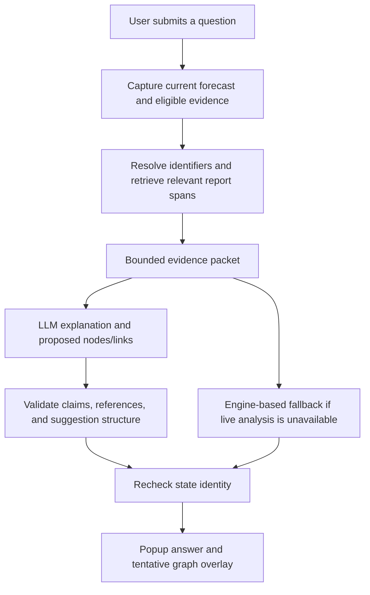

# Ask Davey implementation plan

Date: 2026-11-05
Status: First prototype implemented locally; live OpenAI account check and answer-quality evaluation remain.
Source of product decisions: [Ask Davey brainstorming](ASK_DAVEY_BRAINSTORM.md).

## Implementation checkpoint

The first prototype now includes the submit-only popup, a bounded eligible-evidence search, strict-schema OpenAI Chat Completions integration behind `LOCKER_DAVEY_LIVE=1`, a calculated fallback, revision-bound evidence links, and reviewable AI-proposed Dominoes overlays. The backend checks exercise identity before and after analysis, and suggestion review does not write to the scenario. Browser and backend tests cover the KESSLER E2/E3 walkthrough with a mocked live model. A real Platform key has not been configured or used in this workspace, so response quality, latency, and account access still need a live check.

## 1. Intended outcome

A captain opens **Ask Davey** on Mission Overview or Davy's Dominoes and submits a question about developing mission risks. Davey combines calculated readiness with relevant, currently available reports to explain known constraints and identify emerging concerns. It can suggest report-supported nodes and relationships for review in the graph.

The first walkthrough focuses on **parts and repairs**: KESSLER's SPY-1D cooling-pump supply delay and a tentative report about technical-assistance travel. See the [source-backed walkthrough](ASK_DAVEY_BRAINSTORM.md#selected-theme-parts-and-repairs).

### Confirmed requirements

- A usable prototype leads; demo value and exploration support it.
- Early warning is the main job, covering both calculated warnings and emerging concerns.
- A compact floating popup opens above the fixed **Ask Davey** button on both target pages.
- Analysis starts only after an explicit submitted question. Opening the popup, navigating, or refreshing sources does not initiate Davey analysis.
- Davey may propose new nodes and missing relationships when supported by reports.
- Suggestions are reviewable only in this prototype. Review does not change the engine, apply a what-if scenario, or alter readiness.
- Use **approach B: searchable evidence service**, rather than only a fixed set of records.
- Target the **OpenAI API**. The user already has a Platform API key to supply through local server configuration; `gpt-4o-mini` is the configurable prototype default.

### Implemented prototype defaults

These defaults can be refined after the live walkthrough:

| Detail | Prototype behavior |
| --- | --- |
| Mission Overview context | Selected ship and its upcoming missions in the existing 30-day view; allow an explicit mission selection in the popup |
| Dominoes context | Selected ship, focused mission or all missions, and an explicitly selected node when relevant |
| Mission assessment | Use the engine's full event-interval assessment and active dates; distinguish start-time estimates |
| Conversation lifetime | Separate in-memory chats for Mission Overview and Davy's Dominoes in the current browser tab; navigation restores each page's own chat |
| Clear chat | The popup's **New conversation** control clears only the active page's chat, draft, and review state without requesting analysis |
| Review controls | Mark reviewed and dismiss; these affect the suggestion display only |
| Scope changes | A different ship or mission starts a new context; previous answers are not silently reused as current evidence |
| Report search | Exact identifiers plus lexical search over eligible accepted records; no vector database required initially |
| Answer rendering | Show a complete validated answer; defer token streaming |
| Initial presentation limits | Up to three warnings, four proposed nodes, and six proposed links per answer; disclose truncated results |

## 2. Page experience

Place the fixed **Ask Davey** button in the shared shell on `/missions` and `/dominoes`, with a small **AI** label. Match the Ship and Shore assistant's floating popup layout and conversation bubbles while keeping predictive warnings, forecast claims, and reviewable Dominoes suggestions. The popup opens above the button, empty or to the existing thread for its current context. Suggested questions fill the input; submission initiates requests. Do not display an automatic new-warning badge.

Each page identifies its chat in the popup. Switching pages closes the popup; reopening it restores that page's own questions and answers. **New conversation** resets the active page's conversation. Mission scope follows the selected unit in the header; the popup names that unit and the mission it answered, since Mission Overview shows all units. A Mission Overview suggestion explicitly sent with **Show in Dominoes** appears on the Dominoes graph for review, while its answer stays in the Mission Overview chat. The Dominoes popup labels the traced suggestion's origin.

The popup shows the selected ship and mission scope, the question, loading status, and the answer. Separate **Forecasted warnings** from **Emerging concerns / Needs verification**. Each warning offers evidence inspection, an explanation, and **Trace in Dominoes** where a valid graph relationship exists.

Show the actual generation source on each answer: **Live LLM**, **Cached AI**, or **Rules-based fallback**. Also show exercise time separately from answer-generation time. Endpoint configuration alone does not justify a Live LLM badge.

Use one popup for Davey and evidence inspection so the assistant and existing detail panel do not obscure one another. Evidence opens within the popup with a return-to-conversation action. Clicking an existing graph node can still open the ordinary detail view, preserving Davey's thread for return. Coordinate Escape handling and restore keyboard focus to the launching control. On small screens, cap the popup to the available width and height and scroll its answer content.

## 3. Request architecture

The server owns evidence selection and validation. The model receives a bounded packet and returns structured output. It does not choose filesystem paths or invoke arbitrary tools. The initial feature needs no assistant mutation endpoint.

### State identity and locking

Capture the selected scope, forecast, and immutable eligible evidence under `AppState.lock`. Capture actual text and projected values, not paths that may disappear when source refresh cleans up the old snapshot. Release the lock before retrieval work on the captured data and before any model call.

Each packet and answer carries a process epoch, source revision, scenario version and digest, exercise cursor, selected ship/mission/node scope, and source-health identity. The cache key also carries prompt and output-schema versions. The digest reflects engine assumptions and scenario changes. The client sends its expected state identity; the server resolves the actual scope against current state.

Recheck identity before returning an answer or serving its evidence. If state changed while analysis ran, return a structured `409` and invite a new explicit question. Do not automatically retry against the new state. A process epoch prevents a restart from making a reused version number appear current.

Use request IDs to deduplicate repeated submits and bound concurrent work. Allow one active request per popup. Closing the popup or changing context cancels the client request where possible and always prevents a late response from being installed into a different context; server work remains bounded by its deadline even if cancellation cannot stop it immediately.

## 4. Evidence service

Build a lightweight in-memory search index lazily for an explicit request. Reuse immutable source text already loaded by ingestion where possible. Source refresh invalidates the old index; it does not start model analysis or proactively rebuild Davey's answers.

### Initial corpus

| Evidence | Construction rule |
| --- | --- |
| Mission and dependency calculations | Capture the active forecast, gate/item identifiers, explanations, and typed numeric fields |
| Maintenance and requisitions | Project explicitly allowed fields from `View.rows` and `View.requisitions`, with active status and eligible history |
| CASREPs | Use eligible message sets, identities, timestamps, corrections, and narrative spans |
| Daily reports | Use eligible documents from `View.docs`, segmented into coherent bullets/sections with page and span locators |
| Extracted facts | Attach extraction status and corroboration to the matching source span; an unconfirmed report is not an engine fact |
| Source health | Include the mission's coverage issues, stale linked files, and last refresh status |

Keep the corpus inside the accepted application snapshot. Do not search the repository, the separate reference package, expected-fact fixtures, model caches, or future exercise-feed entries.

### Temporal rules

- Filter by knowledge time before ranking. An upcoming scheduled date can be known now; an unreleased future report cannot.
- `View.requisitions` filters its parsed history, but a raw row may still contain the original full `status_history` string. Build field projections instead of serializing entire rows.
- Do not pass the full dashboard or `/api/state` response to the model: those payloads include exercise-feed metadata that is not decision evidence at earlier cursors.
- Preserve source corrections and supersession. Older eligible reports may support a historical change, but must not be presented as the current status.
- Segment mixed-time content and exclude spans whose visibility cannot be established. Never retrieve a whole row or page merely because one field or paragraph is eligible.
- Use active forecast dates rather than raw event definitions that may incorporate a later schedule change.

### Retrieval sequence

1. Validate the question length and selected ship/mission/node against the captured state.
2. Resolve known equipment aliases, job numbers, requisitions, CASREPs, and part identifiers from the selected scope and question.
3. Search eligible records by exact identifiers first, then normalized lexical matches. Include relevant report history and corrections.
4. Retrieve narrative evidence beyond existing graph nodes so a report-supported outside team can be found. Any scope expansion must retain the selected-unit and knowledge-time boundaries.
5. Deduplicate overlapping spans and diversify across relevant records. Report matches as evidence relevance, not confidence that a claim is true.
6. Return a bounded result set with source coverage and truncation information. Initial design limit: 12 evidence spans and 12,000 narrative characters, plus a separately bounded structured forecast packet; tune after the walkthrough evaluation.
7. Redact personnel identifiers using existing redaction patterns before transmission. Apply the PII guard to the complete outgoing prompt, including the user question and retained follow-up context.

Each evidence item has a stable content-based ID, source revision, unit, document/record identity, knowledge time, page/line/row/set locator, exact eligible excerpt, content hash, and relevant uncertainty or supersession flags. Preserve the mapping between redacted text and its local source locator.

The current `/api/source` endpoint returns raw record windows or whole PDF pages and resolves the current snapshot. Davey's evidence action should serve captured, eligible excerpts by answer/evidence ID with a state check, rather than sending a model-chosen path to that endpoint. Reuse the existing evidence presentation where practical.

## 5. Proposed API and response contract

These endpoints are implemented by the prototype.

| Interface | Purpose |
| --- | --- |
| `POST /api/davey/ask` | Submit a question, selected scope, expected identity, request ID, and optional previous-answer ID |
| `GET /api/davey/answers/{answer_id}/evidence/{evidence_id}` | Read a captured eligible excerpt after validating answer scope and state identity |

Keep a bounded, expiring in-memory answer store for follow-up references and evidence. A restart invalidates answer IDs. Review state is browser-session data in this prototype and does not require a server mutation endpoint.

| Response field | Responsibility |
| --- | --- |
| `identity`, `answer_id`, `request_id` | Bind the answer to its source/state/context |
| `ship_id`, `event_id`, `requested_event_id`, `node_id` | Distinguish the resolved mission from the scope selected in the popup, including “Most urgent mission” |
| `generation` | Actual live/cache/fallback mode, generation time, and relevant failure reason |
| `forecast_claims` | Server-supplied typed values and stable claim IDs from the engine |
| `warnings` | Type, bounded explanation, affected mission IDs, claim/evidence references, and verification needed |
| `proposed_nodes` | Proposed identity, entity kind, source-supported label, cited spans, and tentative status |
| `proposed_links` | Valid endpoints, relation type, cited evidence, explanation, and tentative status |
| `evidence` | Captured eligible excerpts and locators |
| `coverage` | Records searched, relevant gaps, and truncation; no unsupported assertion of exhaustive coverage |

Resolve follow-ups from current server-held answer references and newly retrieved evidence. Previous model prose is conversation context, not independent factual support. Bound retained turns and validate their identity; an expired or stale answer reference requires a fresh explicit request.

### Output validation

- Validate structure, length limits, known mission/entity references, evidence membership, and exact supporting spans.
- Render readiness numbers and authoritative dates from typed server fields. The model cannot supply a new readiness percentage or turn a shipping estimate into a delivery estimate.
- Preserve source hedging. The technical-assistance report's possible travel delay must remain tentative.
- Require evidence for a proposed node and separately for every proposed relationship. A valid quote mentioning an organization does not establish its availability or causal effect.
- Reject missing endpoints, duplicate suggestions, self-links, and unsupported relation types. Resolve exact known entities before creating a new suggestion; ambiguous identity stays explicit.
- Treat retrieved text as data. A report cannot instruct Davey to change its scope, bypass validation, or apply an action.
- On invalid output, use a clearly labeled fallback and report that emerging-concern analysis is unavailable. Do not convert a failed analysis into "no risks found."

These guards establish structure and evidence linkage, not full semantic entailment. Evaluation must check whether explanations actually follow from their cited evidence. Proposed concerns remain hypotheses for human review.

## 6. Graph suggestions and review

Return suggestions as a separate overlay, leaving the existing calculated graph payload intact. Use distinct proposal IDs and a dedicated proposed-node card rather than forcing a new entity into a normal readiness node.

Initial entity kinds can cover support teams, organizations, parts, repair tasks, and equipment, provided the report supports the label and the entity is not already represented. The first acceptance example uses the NSWC technical representative.

Show dashed outlines/links and an explicit **AI-proposed** label. Existing graph condensation also uses dashed edges, so the label and distinct card styling are required for clarity. Proposed cards have no probability, readiness color, timeline curve, or next-domino ranking.

Define relation direction explicitly. The captain adapter currently draws mission-to-requirement-to-item edges, while the backend graph export uses dependency-to-dependent edges. Resolve one semantic relation in the service and adapt it deliberately to the captain graph. Do not interchange the two graph ID formats.

**Trace in Dominoes** selects the appropriate mission, reveals needed existing nodes, adds the selected answer's overlay, and frames the relevant chain beside the popup. Highlighting and visibility are view state, not scenario mutations. Omit overlays from calculated counts, critical-path scoring, and simulated cascade effects.

Inspection opens evidence and the reason for verification. **Mark reviewed** records that someone inspected a suggestion; it does not mean the claim is confirmed. **Dismiss** hides it from the active overlay and retains it in the current answer's dismissed list. State changes remove current overlays and mark their originating answers outdated.

## 7. LLM runtime, caching, and fallback

### OpenAI integration

Use the existing Chat Completions transport for this increment. OpenAI recommends Responses for new projects, but this application already has a compatible client, so retaining its API shape limits the integration change. This is a design choice for LOCKER, not a claim that Chat Completions is preferred for every new application. [Official Chat Completions reference](https://developers.openai.com/api/reference/resources/chat/subresources/completions/methods/create).

For Davey, request Structured Outputs using a supported JSON schema with strict mode, then apply the domain/evidence validation above. Handle refusals and incomplete responses explicitly; schema adherence does not prove factual correctness. [Official Structured Outputs guide](https://developers.openai.com/api/docs/guides/structured-outputs?api-mode=chat).

The legacy wrapper sends `json_object`, `max_tokens`, and `temperature: 0`. Davey now has a separate strict JSON-schema request path using `max_completion_tokens`. Parameter support varies by model, so the selected model still needs a live account check. [Official request parameters](https://developers.openai.com/api/reference/resources/chat/subresources/completions/methods/create).

Use the application's existing server configuration names from [.env.example](../.env.example):

| Setting | Prototype use |
| --- | --- |
| `LLM_BASE_URL` | `https://api.openai.com/v1` |
| `LLM_API_KEY` | The user's OpenAI Platform API key, supplied locally through the server environment or ignored `.env` file |
| `LLM_MODEL` | Configurable OpenAI model identifier; choose and test a model that supports the required response schema |
| `LOCKER_DAVEY_LIVE` | Implemented opt-in setting for the Davey client only; defaults to off |

The backend sends bearer authentication. Keep the key in server configuration and out of browser state, source documents, and request logs, following [official OpenAI authentication guidance](https://developers.openai.com/api/reference/overview#authentication). The repository already ignores `.env`; this implementation has not configured or tested the user's credential.

### Request behavior

The implementation reuses the existing compatible client interface, validation, caching, and redaction patterns. Davey has its own task, prompt/schema version, and 30-second request deadline, with at most one transport retry using the remaining budget. There is no automatic repair loop or repeated model call after invalid structured output.

Cache keys include the question and follow-up context hash, complete eligible evidence and forecast identity, prompt/schema/policy versions, and model identity. Revalidate cached output and state before use. A citation or record changing must invalidate the corresponding answer.

The demo launcher forces `MISSIONTWIN_DEMO_MODE=1`, keeping ingestion and other legacy model tasks offline. Davey uses a separate `LOCKER_DAVEY_LIVE=1` opt-in and a task-specific client configuration with the endpoint and key above. It sends no model request during startup or when the popup opens.

Fallback output can show calculated warnings and retrieved evidence without generating novel hypotheses. Label cached model output as cached and deterministic output as fallback. Existing numeric/citation guards alone are not sufficient for the new suggestion task.

## 8. Implementation sequence

The sequence below guided the prototype. The live account check in step 6 remains outstanding.

| Step | Main work | Files and integration points | Completion evidence |
| --- | --- | --- | --- |
| 1. Define contracts and capture state | Typed request/response models, stable graph references, immutable packet, identity checks | New `missiontwin/davey_models.py` and `missiontwin/davey.py`; integrate [api.py](../missiontwin/api.py) | E2/E3 packets expose only eligible facts; no scenario mutation |
| 2. Implement evidence retrieval | Project rows, segment reports, resolve aliases, exact/lexical retrieval, bounded eligible excerpts | New `missiontwin/davey_evidence.py`; reuse [ingest.py](../missiontwin/ingest.py) and [sources.py](../missiontwin/sources.py) | Relevant CASREP and travel-report spans retrieved at the correct cursor; source refresh invalidates the index |
| 3. Add generation and validation | Davey-specific OpenAI request options and strict response schema, output guards, deadline, cache, deterministic fallback, ask/evidence routes | [llm.py](../missiontwin/llm.py), new Davey modules, [api.py](../missiontwin/api.py) | Mocked live, cache, refusal/truncation, malformed output, unavailable-model, and state-change cases behave as specified |
| 4. Build Ask Davey | Floating popup, explicit submit flow, scope display, warnings, evidence, thread state, outdated-answer behavior | New `web/src/captain/components/davey/` and dedicated Davey state; [AppShell.tsx](../web/src/captain/components/layout/AppShell.tsx), [api.ts](../web/src/captain/api/api.ts), [types.ts](../web/src/captain/api/types.ts), [DetailPanel.tsx](../web/src/captain/components/layout/DetailPanel.tsx) | Opening/navigation causes no ask request; submitting once produces one bounded request; keyboard and evidence navigation work |
| 5. Add tentative graph overlay | Proposed cards/links, canonical ID mapping, trace/focus, review/dismiss controls | [Dominoes.tsx](../web/src/captain/screens/Dominoes.tsx), [DominoGraph.tsx](../web/src/captain/components/graph/DominoGraph.tsx), graph layout/types, new proposed-node card | Proposed NSWC node traces to the repair; baseline graph, readiness, and scenario log remain unchanged |
| 6. Verify the complete walkthrough | E2/E3 evidence, follow-ups, stale answers, outage handling, live configuration documentation | New focused backend/browser tests; reuse [check_demo.py](../scripts/check_demo.py); update setup docs | Isolated walkthrough and relevant regression checks pass; optional live evaluation reports observed answer quality and latency |

Do not implement generation through the existing generic [useApi hook](../web/src/captain/state/useApi.ts): it fetches on mount and refreshes on version changes. Use a dedicated submit handler. Existing version polling can mark answers outdated without issuing new questions.

The assistant provider should survive route-content animation between the two target pages for the same context. Coordinate it with the existing [store](../web/src/captain/state/store.tsx), which remounts children on ship changes. Treat the store's UI version counter as a refresh signal, not as the server scenario identity.

## 9. Acceptance and evaluation

| Case | Required result |
| --- | --- |
| Open, close, navigate, or change sources without asking | Zero new Davey ask/model calls |
| Submit a question at E2 | Explain the current supply constraint without using the E3 report or E4 schedule change |
| Submit after E3 | Retrieve the travel report, preserve its uncertainty, and offer a supported representative node/link |
| Assistance date is already modeled | Explain that fact and avoid adding another calculated effect |
| Conflicting repair and shipping estimates | Keep values and source roles distinct; identify the inconsistency without inventing a completion date |
| Unsupported entity or mismatched citation | Reject the unsupported proposal and report the analysis limitation |
| Suggestion review/dismissal | Only display/review state changes; engine forecast, scenario version, action log, and inputs are unchanged |
| Source refresh, undo/reset, or restart during a request | Reject obsolete output; no silent automatic regeneration |
| Superseded record or future history embedded in a row | Exclude future values and identify historical records accurately |
| Model unavailable, timed out, or returns invalid JSON | Bounded request ends with a truthful fallback; no false all-clear |
| Cached answer | Accept only matching content/state/policy and display the cached source label |
| Proposed graph entity | Clear AI label, accessible evidence, no invented probability, and stable original node selection |
| Follow-up across a scope change | No previous mission's evidence or late answer is silently reused |

Use meaningful backend tests for temporal filtering, evidence linkage, concurrency, and non-mutation; browser checks for the submit-only contract, navigation, evidence, and graph review. Use the isolated demo runner rather than resetting an existing running workspace.

Before declaring live readiness, evaluate the selected model on the E2/E3 sequence, an unrelated question, an ambiguous entity, conflicting evidence, and an injected instruction in a source. Record retrieval coverage, citation support, hedging preservation, unsupported suggestions, observed latency, and model/prompt versions. Do not use prose similarity to a reference answer as the sole quality measure.

## 10. Remaining inputs and limits

OpenAI is the selected provider. The prototype defaults to `gpt-4o-mini`; model selection remains configurable. Set response-time and cost targets for evaluation, then verify account access, schema compatibility, and answer quality during a live integration check. Credentials belong in local server configuration; no credential or live model access was tested in this workspace.

The UI/session/review defaults above and the proposed KESSLER walkthrough can be refined during design review. This plan does not add autonomous monitoring, automatic actions, persistent multi-user reviews, uploads, fleet-wide search, or a new readiness model.

The earlier [Captain decision assistant plan](CAPTAIN_DECISION_ASSISTANT_PLAN.md) provides useful background for immutable packets and eligible evidence. This document defines the selected Ask Davey workflow and its first-prototype scope.
